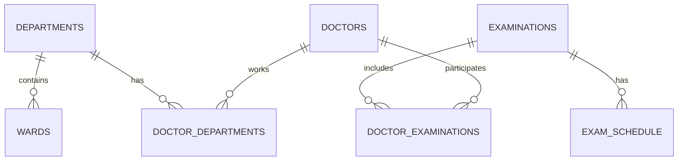

# Учебная работа по базе данных «Больница»

Я сделал модель не слишком сложной, чтобы она была понятна на уровне учебной работы.

## 1. Предметная область

В больнице есть врачи, отделения, палаты и обследования.  
У обследований есть расписание. Один вид обследования может проводиться в разные дни.  
Один врач может проводить несколько обследований, а одно обследование могут проводить несколько врачей.  
Также я решил, что врач может работать больше чем в одном отделении.

## 2. Сущности

### departments
Отделения больницы.

Поля:
- `id` — первичный ключ;
- `name` — название отделения, уникальное.

### wards
Палаты.

Поля:
- `id` — первичный ключ;
- `department_id` — внешняя ссылка на отделение;
- `room_number` — номер палаты;
- `ward_type` — тип;
- `capacity` — вместимость.

Номер палаты уникален внутри конкретного отделения.

### doctors
Врачи.

Поля:
- `id` — первичный ключ;
- `full_name` — ФИО;
- `specialty` — специальность;
- `phone` — телефон.

### examinations
Виды обследований.

Поля:
- `id` — первичный ключ;
- `name` — уникальное название;
- `description` — описание.

### exam_schedule
Расписание обследований.

Я вынес расписание отдельно, потому что одно обследование может быть, например, в понедельник и в среду.

Поля:
- `id`;
- `examination_id`;
- `day_of_week`;
- `start_time`;
- `end_time`.

Для дня недели использованы числа 1–7.  
Есть `CHECK`, чтобы время начала было меньше времени окончания.

### doctor_examinations
Связующая таблица врачей и обследований.

Связь многие-ко-многим.

### doctor_departments
Связующая таблица врачей и отделений.

Тоже связь многие-ко-многим.

## 3. Связи

- departments 1:M wards;
- examinations 1:M exam_schedule;
- doctors M:N examinations;
- doctors M:N departments.

## 4. Простая ER-схема



## 5. Почему модель находится примерно в 3НФ

Я старался не хранить одинаковые данные в нескольких местах.

Например:
- название отделения не хранится в таблице врача;
- название обследования не копируется в расписание;
- связи многие-ко-многим вынесены в отдельные таблицы;
- данные расписания не находятся прямо в `examinations`.

Поэтому при изменении названия отделения или обследования не нужно менять много строк в других таблицах.

## 6. Ограничения

Использованы:
- `PRIMARY KEY`;
- `FOREIGN KEY`;
- `NOT NULL`;
- `UNIQUE`;
- `CHECK`.

Самое важное ограничение времени:

```sql
CHECK (start_time < end_time)
```

## 7. Ответы на дополнительные вопросы

### Почему день и время в отдельной таблице?
Потому что одно обследование может проводиться несколько раз в неделю. Если хранить день недели прямо в `examinations`, пришлось бы делать несколько полей или дублировать обследование.

### Может ли врач участвовать в нескольких обследованиях?
Да. Поэтому используется таблица `doctor_examinations`.

### Может ли обследование проводиться несколькими врачами?
Да. Та же таблица это позволяет.

### Должен ли врач быть обязательно привязан к отделению?
В моей модели врач может быть связан с одним, несколькими отделениями или пока не иметь связи.

### Какие значения уникальны?
- название отделения;
- название обследования;
- телефон врача;
- номер палаты внутри отделения.

## 8. Историчность

Для второй части я выбрал SCD Type 2.

Я решил хранить историю:
1. расписания обследований;
2. связи врач — обследование;
3. связи врач — отделение.

Причина простая: эти данные могут меняться, и иногда нужно понять, как было раньше.

Я не делал историю для всех полей врача и справочников, потому что для учебной работы это сильно усложнило бы модель.

Исторические таблицы содержат:
- бизнес-ключ;
- отдельный `history_id`;
- `valid_from`;
- `valid_to`;
- `is_current`;
- `operation`.

У текущей версии `valid_to IS NULL` и `is_current = TRUE`.

## 9. Бизнес-ключ и ключ версии

Например, в `exam_schedule_history`:

- `schedule_id` — это бизнес-ключ исходной строки расписания;
- `history_id` — это ключ конкретной исторической версии.

Нельзя сделать `schedule_id` единственным первичным ключом истории, потому что для одного `schedule_id` должно храниться несколько строк-версий.

## 10. Зачем нужен is_current

По `valid_to IS NULL` уже можно понять, что версия текущая.  
Но `is_current` делает запрос проще:

```sql
SELECT *
FROM exam_schedule_history
WHERE is_current = TRUE;
```

## 11. Почему триггер

Если версионирование делать только в приложении, можно случайно выполнить SQL вручную и забыть добавить историю. Триггер работает прямо в PostgreSQL и поэтому для этой учебной задачи мне кажется удобнее.

## 12. Порядок запуска

1. `01_schema.sql`
2. `02_data.sql`
3. `03_queries.sql`
4. `04_history.sql`
5. `05_history_demo.sql`

Например через `psql`:

```bash
psql -U postgres -d hospital_db -f 01_schema.sql
psql -U postgres -d hospital_db -f 02_data.sql
psql -U postgres -d hospital_db -f 03_queries.sql
psql -U postgres -d hospital_db -f 04_history.sql
psql -U postgres -d hospital_db -f 05_history_demo.sql
```

## 13. Что можно расширить потом

Если потребуется, можно добавить:
- пациентов;
- кабинеты;
- оборудование;
- результаты обследований;
- госпитализации.

Я специально не добавлял это сейчас, потому что в основном задании это не требуется.
